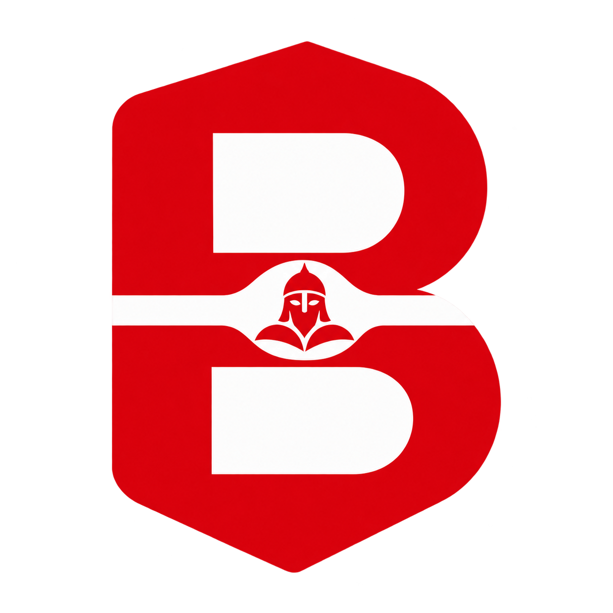

# Battal

{ width="160" align="right" }

Açık kaynak, Türkçe öncelikli AI Safety & Agent Security platformu.

Battal; AI gateway'lerin, code studio/IDE ortamlarının ve agent runtime'ların, içlerinden geçen
içeriği değerlendirmek için çağırdığı bir güvenlik servisidir. Değerlendirilen içerik şunlardır:
kullanıcı girdisi, model yanıtı (streaming dahil), RAG içeriği, tool call'lar ve tool result'lar.
Battal, takılıp çıkarılabilen detector'ları (Türkçe ve Türkçe–İngilizce karışık metin, PII ve
secret, prompt injection, içerik güvenliği) deterministik policy uygulamasıyla tek bir evaluation
API arkasında birleştirir.

!!! warning "Durum"
    Tasarım aşaması tamamlandı: MVP'nin sekiz spec'i (S0–S7) kabul edildi. Kod henüz yazılmadı;
    kullanılabilir bir sürüm yok. Sıradaki adım kodlamadır (backlog E0).

## İlkeler

- **Proxy değildir.** LiteLLM gibi gateway'ler gateway olarak kalır; Battal onların çağırdığı
  guard'dır.
- **Değiştirilebilir bileşenler.** Modeller, scanner'lar ve policy engine'ler sabit interface'lerin
  arkasına takılır.
- **Self-hosted.** Kendi altyapınızda çalışacak şekilde tasarlanır; hassas içeriğin dışarı çıkması
  gerekmez.
- **Açıklanabilir kararlar.** Detector skorları, policy kararı ve gerekçe ayrı alanlardır;
  sürümlenir ve denetlenebilir.

Planlanan dağıtım: Python SDK (`pip install battal`) ve Battal Server (container/Helm).

## Logonun hikâyesi

Kalkan biçimindeki **B**'nin iki bölümü modele giden istekleri ve modelden dönen yanıtları
simgeler. Ortadaki beyaz geçit, ikisinin de güvenlik kontrolünden geçtiği noktadır. Bu geçitte
Battal Gazi'den esinlenen bir muhafız nöbet tutar. Al ve beyaz renkler projenin Türkiye'den
doğduğunu yansıtır.

## Dokümanlar

- [Ürüne genel bakış](urun.md): ürünün bugünkü tasarımının özeti
- [Mimari](mimari.md): bileşenler, modüller ve bağımlılık kuralları
- [Sözlük](sozluk.md): projeye özgü terimlerin tek anlamı
- [Spec'ler](spec/index.md): MVP spec listesi, yazım sırası ve durumu
- [Kararlar (ADR)](decisions/0001-product-shape-and-licensing.md): ürün biçimi ve lisanslama
- [Lisanslama](proje/lisanslama.md)
- [Katkı](proje/katki.md)
- [Güvenlik politikası](proje/guvenlik.md)
